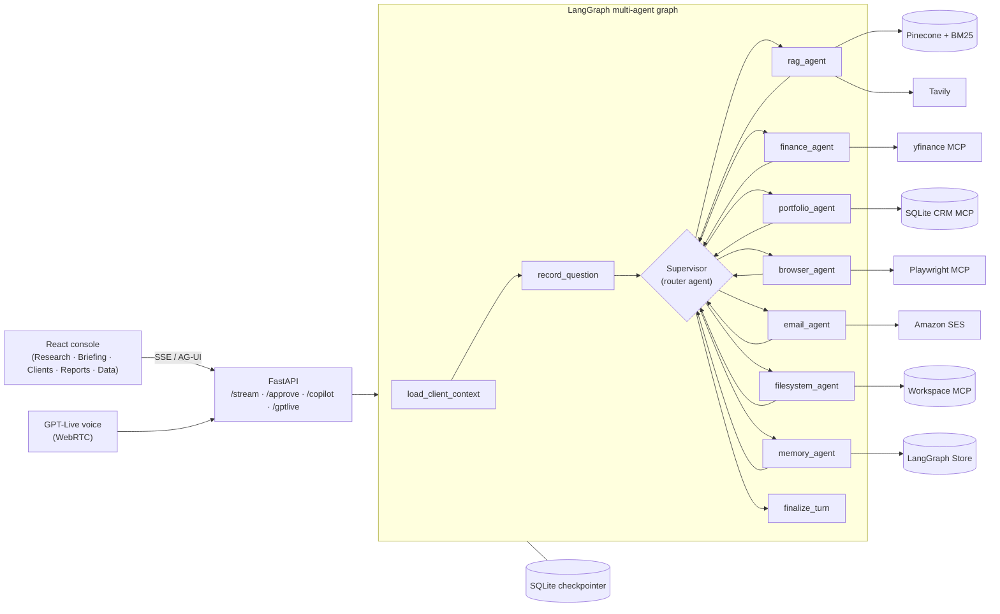

# 🕵️‍♂️ Autonomous Market Intelligence Agent (LangGraph + MCP)

A full-stack, multi-agent AI assistant for **wealth managers**. It researches markets, analyses client portfolios, reads company annual reports, browses the web, and carries out real actions — emails, files, reports — **only after a human approves them**.

You talk to it in plain language, by typing or by voice:

> *"Which clients have more than 30% of their portfolio in a single stock?"*
> *"Compare NVDA vs AMD."* · *"What if Margaret Collins sold half of her NVDA?"*
> *"What were Amazon's revenue segments in 2024 according to the annual report?"*
> *"Send Margaret Collins a short summary of her portfolio."* → an approval card opens before anything is sent.

---

## 🚀 Key Features

| Feature | Components | Why it Matters |
| :--- | :--- | :--- |
| **🧠 Multi-Agent Orchestration** | LangGraph supervisor + 7 specialist agents (LangChain `create_agent`) | Each question goes to the right expert (portfolio, finance, research, browser, email, files, memory); the supervisor chains them when a task needs several. |
| **📚 Hybrid RAG over Reports** | Pinecone vectors + BM25 keywords + `bge-reranker-v2-m3` | Accurate, cited answers from ingested annual reports (`[Source: file, page N]`), including exact figures that pure vector search misses. |
| **💼 Wealth-Management CRM** | SQLite via MCP (`mcp-server-sqlite`) | Clients, holdings, transactions and watchlists the agent can query safely (read-only). |
| **📈 Live Market Data** | Yahoo Finance MCP (`yfmcp`) + `yf.Search` | Quotes, price history, news, multi-ticker comparisons. |
| **🧮 Deterministic Finance Tools** | Python tools (no LLM arithmetic) | Portfolio value, P&L, weights, concentration screens, what-if simulations and watchlist alerts are computed in code — reproducible numbers, even with a small model. |
| **🌐 Web + Headless Browser** | Tavily search, Playwright MCP (Chromium) | Fresh web context, full pages, screenshots as evidence. |
| **📁 Sandboxed Workspace** | Filesystem MCP | Read and write artifacts (notes, CSVs, Excel reports, screenshots) inside `data/workspace/` only. |
| **🧠 Long-Term Memory** | LangGraph `BaseStore` (`AsyncSqliteStore`) | Remembers user facts and preferences across conversations; also indexes the conversation history for semantic search. |
| **👮 Human-in-the-Loop** | `HumanInTheLoopMiddleware` + LangGraph `interrupt()` | Every side effect (email, file write, memory save, report) pauses for **Approve / Edit / Reject**. |
| **🛡️ Guardrails** | Card-number blocking, PII masking, OpenAI moderation, email redaction | Sensitive data never reaches the model or third parties; emails only go to known client addresses. |
| **🖥️ Rich UI** | React 19 + CopilotKit (AG-UI) | Streaming chat with interactive cards (charts, tables, approvals), live activity timeline, conversation history. |
| **🎙️ Voice Mode** | OpenAI GPT-Live (WebRTC) | Speak to the same agent and approve actions by voice (English or Hebrew). |
| **☁️ Production on AWS** | Bedrock AgentCore Runtime + Gateway, Lambda MCP servers, CDK, GitHub Actions | Serverless, infrastructure-as-code deployment with CI/CD. |

---

## 🏗️ Architecture



**How a turn works**

1. The question enters the graph; the client context and the question are recorded.
2. The **supervisor** decides which specialist handles it. Deterministic rules (hop limit, forced finish, portfolio → email chaining) run in Python; the one LLM decision is a structured `RoutingDecision`.
3. The **specialist** (a LangChain `create_agent` with its own tools, prompt and middleware) calls its tools and answers.
4. Control returns to the supervisor, which either chains another specialist or finishes the turn.
5. If a tool has side effects, the run **pauses** with an approval card; `/approve` resumes it.
6. State is checkpointed per `thread_id` (SQLite), so conversations and pending approvals survive restarts.

**The 7 specialists**

| Specialist | Handles | Main tools |
| :--- | :--- | :--- |
| `portfolio_agent` | Clients, holdings, concentration, what-if, watchlists, reports | `client_portfolio`, `concentration_screen`, `simulate_portfolio_change`, `watchlist_alerts`, `read_query`, `save_portfolio_report` |
| `finance_agent` | Quotes, price history, news, comparisons | `yfinance_*`, `compare_companies` |
| `rag_agent` | Company reports and the live web | `search_knowledge_base`, `web_search` |
| `browser_agent` | Visiting pages, screenshots | `browser_navigate`, `browser_snapshot`, `browser_take_screenshot` |
| `email_agent` | Writing and sending emails to clients | `send_email` (approval required) |
| `filesystem_agent` | Workspace files | `list_directory`, `read_text_file`, `write_file` (approval required) |
| `memory_agent` | User facts and preferences | `list_memories`, `recall_memory`, `save_memory` (approval required) |

---

## 🛠️ Technical Sheet

| Area | Choice |
| :--- | :--- |
| **Language / runtime** | Python 3.12+, `uv` package manager; Node 20+ for the frontend and the Node MCP servers |
| **Agent framework** | LangGraph 1.x (graph, checkpointer, store, interrupts) + LangChain 1.x (`create_agent`, middleware) |
| **LLM** | OpenAI `gpt-4o-mini` (configurable via `OPENAI_MODEL`); optional fallback to Claude Sonnet 5.5 when `ANTHROPIC_API_KEY` is set |
| **Embeddings** | OpenAI `text-embedding-3-small` |
| **Vector DB / search** | Pinecone (serverless) + BM25 (`rank_bm25`) + Pinecone rerank `bge-reranker-v2-m3` |
| **Structured data** | SQLite (`customers.db`: companies, clients, holdings, transactions, watchlists) |
| **MCP** | `langchain-mcp-adapters` `MultiServerMCPClient`; servers: `mcp-server-sqlite`, `yfmcp`, `@modelcontextprotocol/server-filesystem`, `@playwright/mcp` |
| **Persistence** | `AsyncSqliteSaver` (conversations, approvals) · `AsyncSqliteStore` with vector index (memory, conversation history) |
| **Middleware** | Human-in-the-loop, PII masking, OpenAI moderation, context editing, summarization, model/tool retry, model fallback, call limits |
| **Backend API** | FastAPI (SSE `/stream`, `/approve`, AG-UI `/copilot/market-desk`, `/gptlive/session`, `/conversations`, `/data/*`) |
| **Frontend** | React 19, TypeScript, Vite, Tailwind, React Router, CopilotKit 1.74 (AG-UI) |
| **Voice** | OpenAI GPT-Live over WebRTC, delegation worker on a sideband WebSocket |
| **Email** | Amazon SES (simulation mode when no sender is configured) |
| **Production** | AWS Bedrock AgentCore Runtime + Gateway, 3 Lambda MCP targets, AgentCore Memory, AgentCore Browser, S3, Cognito, CloudWatch |
| **IaC / CI-CD** | AWS CDK (Python), GitHub Actions with OIDC (deploys on push to `master`) |
| **Quality** | ~740 backend tests (pytest) · ~350 frontend tests (Vitest) · LangSmith tracing |

---

## 🧰 Tools (27)

All MCP-backed tools come from a single `MultiServerMCPClient` registry (`app/agent/mcp_clients/registry.py`). Full details and rationale: **[`docs/TOOLS.md`](market-intelligence-agent/docs/TOOLS.md)**.

| Tool | Type | Backend | What it does |
| :--- | :--- | :--- | :--- |
| `read_query` · `list_tables` · `describe_table` | read-only | MCP / SQLite | Query and explore the CRM schema. |
| `client_portfolio` | read-only | Python | One client's positions, live value, P&L and weights. |
| `portfolio_metrics` · `pct_change` | read-only | Python | Deterministic portfolio math and percentage change. |
| `concentration_screen` | read-only | Python | Clients with more than X% (default 30%) in one stock; ETFs excluded. |
| `simulate_portfolio_change` | read-only | Python | What-if buys/sells → before/after weights. Never writes. |
| `watchlist_alerts` | read-only | Python | Triggered / near / watching alerts against live prices. |
| `compare_companies` | read-only | Python + yfinance | 2–4 tickers side by side (price, P/E, 52-week range, return, chart). |
| `yfinance_get_ticker_info` · `yfinance_get_price_history` · `yfinance_get_ticker_news` | read-only | MCP / yfmcp + `yf.Search` | Quote, history, news. |
| `search_knowledge_base` | read-only | Pinecone + BM25 + rerank | Hybrid search over ingested reports, with page citations. |
| `web_search` | read-only | Tavily | Live web search (top 3, advanced depth). |
| `browser_navigate` · `browser_snapshot` · `browser_take_screenshot` | read-only | MCP / Playwright | Headless browsing and screenshots. |
| `read_text_file` · `list_directory` | read-only | MCP / filesystem | Read the workspace. |
| `recall_memory` · `list_memories` | read-only | LangGraph Store | Read saved user facts. |
| `ask_user_choice` | interactive | LangGraph `interrupt()` | Button/checkbox choice card in the UI. |
| `write_file` | **approval** | MCP / filesystem | Write a file into the workspace. |
| `save_memory` | **approval** | LangGraph Store | Save a user fact. |
| `save_portfolio_report` | **approval** | Python (xlsxwriter) | Build and save an Excel portfolio brief with a pie chart. |
| `send_email` | **approval** | Amazon SES | Email a client (only to addresses in `clients.email`). |

---

## 🛡️ Safety by Design

* **Human approval** on every side effect, with Approve / Edit / Reject (edit the email before it leaves).
* **Credit-card guard**: a card number in a question ends the turn before any model call.
* **PII masking** on model input, output and tool results; email addresses are redacted for the agents that talk to third parties.
* **Moderation** (`omni-moderation-latest`) on input and output.
* **Email recipient guard**: `send_email` only accepts addresses of known clients, checked again after approval.
* **Read-only retries only**: transient errors are retried for read-only tools; side-effect tools are never retried.
* **Sandbox**: file tools are confined to `data/workspace/`; the CRM is read-only.

---

## 🖥️ The Console

| Page | What you do there |
| :--- | :--- |
| **Research** | Chat with the agent (text or voice): interactive cards, approval cards, follow-up suggestions, activity timeline, searchable conversation history (`/research?c=<thread_id>`). |
| **Briefing** | Global markets by region (U.S., Europe, Asia, Latin America, currencies, crypto), movers, news, concentration alerts. |
| **Clients** | Search and filter clients, open a client workspace. |
| **Reports** | Client snapshots and generated Excel reports. |
| **Data** | Ingested documents library; import PDFs (indexed into Pinecone) and spreadsheet data. |

---

## 🎯 Demo Scenarios

| Ask | What happens |
| :--- | :--- |
| *"Which clients have more than 30% in a single stock?"* | `portfolio_agent` → `concentration_screen` → breach list card. |
| *"Compare NVDA vs AMD"* | `finance_agent` → `compare_companies` → table + rebased chart. |
| *"What if Margaret sold half her NVDA?"* | `portfolio_agent` → `simulate_portfolio_change` → before/after card; nothing executed. |
| *"What were Amazon's revenue segments in 2024?"* | `rag_agent` → `search_knowledge_base` → cited answer (page numbers). |
| *"Open example.com and take a screenshot"* | `browser_agent` → Playwright → screenshot shown inline. |
| *"Generate a portfolio report for Robert Hayes"* | Approval card → Excel brief with a Download button. |
| *"Send Margaret Collins a summary of her portfolio"* | `portfolio_agent` gathers the figures → `email_agent` drafts → editable approval card → SES. |
| *"My card is 4111 1111 1111 1111, what's AAPL?"* | Blocked before any model call. |

---

## 📦 Installation

### Prerequisites

* Python **3.12+** and [`uv`](https://docs.astral.sh/uv/) (`pip install uv`)
* Node **20+** (frontend and the filesystem / Playwright MCP servers)
* API keys: **OpenAI**, **Pinecone** (with an existing index), **Tavily**

### 1. Clone and install

```bash
git clone https://github.com/YanivBohbot/Autonomous-Market-Intelligence-Agent.git
cd Autonomous-Market-Intelligence-Agent/market-intelligence-agent

uv sync                                   # Python dependencies
cd frontend && npm install && cd ..       # frontend dependencies
npx -y @playwright/mcp@latest install-browser chrome-for-testing   # browser for the Playwright MCP
```

### 2. Configure `.env`

Create `market-intelligence-agent/.env`. The app refuses to start if a required key is missing.

```ini
# Required
OPENAI_API_KEY=...
OPENAI_MODEL=gpt-4o-mini
OPENAI_EMBEDDING_MODEL=text-embedding-3-small
PINECONE_API_KEY=...
PINECONE_INDEX_NAME=...
TAVILY_API_KEY=...

# Email (leave EMAIL_SENDER empty to simulate sending)
EMAIL_SENDER=
EMAIL_PASSWORD=
EMAIL_SMTP_SERVER=
EMAIL_SMTP_PORT=0

# Optional
COPILOT_ENABLED=true          # enables the Research console endpoint (/copilot/market-desk)
ANTHROPIC_API_KEY=            # enables the Claude fallback model
LOG_LEVEL=INFO
```

Other optional settings (workspace path, browser backend, moderation, store backend…) are listed in [`CLAUDE.md`](market-intelligence-agent/CLAUDE.md#required-env-keys) and `app/core/config.py`.

### 3. Prepare the data (once)

```bash
uv run python create_db.py      # (re)build the CRM database customers.db
uv run python -m app.ingest     # index the PDFs in ./data/ into Pinecone + the BM25 corpus
```

---

## ▶️ Run Locally

Two terminals, from `market-intelligence-agent/`:

```bash
# Terminal 1 — backend (http://localhost:8000)
uv run uvicorn app.api.server:app --host 0.0.0.0 --port 8000

# Terminal 2 — React console (http://localhost:5173)
cd frontend && npm run dev
```

Then open **http://localhost:5173/research**.

* Health check: http://localhost:8000/health
* API docs (OpenAPI): http://localhost:8000/docs
* Voice: click the 🎤 button in Research (needs a microphone; see [`docs/VOICE.md`](market-intelligence-agent/docs/VOICE.md)).

### Run in Docker

```bash
docker compose up --build
```

The image includes Node 20 and Chromium and pre-pulls the MCP packages.

---

## 🧪 Tests

```bash
uv run pytest tests/ -v                  # backend unit tests
cd frontend && npx vitest run            # frontend tests
cd frontend && npx tsc --noEmit          # type check
uv run python test_agent.py              # live smoke test against the agent
```

A manual QA checklist lives in [`docs/QA-GUIDE.md`](market-intelligence-agent/docs/QA-GUIDE.md).

---

## ☁️ Production (AWS)

The agent runs on **Amazon Bedrock AgentCore**:

* **AgentCore Runtime** hosts the container (`Dockerfile.agentcore`, `requirements.agentcore.txt` pinned to `uv.lock`).
* **AgentCore Gateway** exposes the MCP tools over HTTPS, backed by **3 Lambda** targets (yfinance, SQLite CRM, filesystem on S3), protected by a **Cognito** OAuth client-credentials pool.
* **AgentCore Memory** stores durable checkpoints so approvals survive across containers; **AgentCore Browser** replaces local Chromium.
* **Amazon SES** sends the emails; **CloudWatch** handles logs and dashboards.
* Everything is defined with **AWS CDK** in [`prod/iac/`](prod/iac) and deployed by **GitHub Actions** (OIDC, no stored AWS keys) on every push to `master`.

See [`prod/STATE.md`](prod/STATE.md) for what is deployed and how to verify it.

---

## 📂 Project Layout

```
market-intelligence-agent/
├── app/
│   ├── agent/
│   │   ├── orchestration/       # graph, supervisor (router agent), state
│   │   ├── agents_specialist/   # the 7 specialists (create_agent)
│   │   ├── tools/               # native tools (finance, portfolio, email, memory, RAG…)
│   │   ├── mcp_clients/         # MCP registry + per-server clients
│   │   ├── prompts/             # supervisor and specialist prompts
│   │   ├── guardrails/          # credit-card guard
│   │   ├── memory/              # LangGraph store, conversation index
│   │   └── middleware.py        # shared middleware factories
│   ├── api/                     # FastAPI server, routers, models
│   ├── rag/                     # loaders, splitter, vector store, BM25, retriever
│   ├── voice/                   # GPT-Live delegation worker, voice HITL
│   ├── mcp_servers/             # our own MCP server (browser)
│   └── ingest.py                # PDF ingestion CLI
├── frontend/                    # React console
├── tests/                       # pytest suite
├── docs/                        # TOOLS, VOICE, QA guide, project overview, specs & plans
├── create_db.py                 # seeds customers.db
└── Dockerfile / Dockerfile.agentcore
```

---

## 📖 Further Reading

* [`docs/PROJECT_OVERVIEW.md`](market-intelligence-agent/docs/PROJECT_OVERVIEW.md) — the project end to end, in French (architecture, infra, LangChain/LangGraph concepts)
* [`docs/TOOLS.md`](market-intelligence-agent/docs/TOOLS.md) — every tool: what it does and why it exists
* [`docs/VOICE.md`](market-intelligence-agent/docs/VOICE.md) — voice mode setup
* [`CLAUDE.md`](market-intelligence-agent/CLAUDE.md) — developer reference (commands, environment, architecture details)
